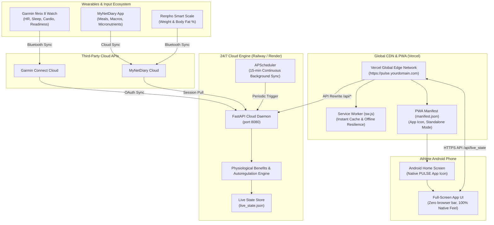

# PULSE • Production Launch & 24/7 Cloud Architecture Guide

**System:** PULSE • Hybrid Athlete OS  
**Deployment Target:** Cloud PWA (Vercel) + 24/7 Live Cloud Engine (Railway / Render)  
**Status:** Codebase Prepared & Verified  

---

## 1. System Architecture & Data Flow



---

## 2. How You Will Use The App in Production

Once launched, **you will never open an offline file or Google Drive link again**.

1. **Install to Your Phone**:
   - You open your live production URL (e.g. `https://pulse-athlete.vercel.app` or your custom domain).
   - In Chrome, tap the 3 dots in the top right corner and tap **"Install App"** (or tap the **"Add PULSE to Home Screen"** prompt).
   - A dedicated **PULSE app icon** appears right on your Android home screen alongside Garmin Connect and MyNetDiary.
2. **Launch & Look**:
   - Tapping the icon launches the app in **standalone full-screen mode**.
   - There is **no browser address bar, no navigation buttons, and no `content://` sandbox limits**.
   - It looks, feels, and performs identically to a native app downloaded from the Google Play Store.
3. **24/7 Automatic Live Sync**:
   - When you finish a run, walk, or cardio session on your Garmin fēnix 8, your watch syncs to Garmin Connect.
   - Your cloud backend daemon runs continuously in the cloud, pulls your new session, processes the biomechanical and cardiovascular recovery profile, and recalculates your daily caloric runway.
   - The next time you glance at your phone, **your metrics are already updated**.

---

## 3. Step-by-Step 5-Minute Launch Instructions

The codebase is already organized and verified in `/home/antigravity/` and `/home/antigravity/backend/`.

### Step 3.1: Deploy the 24/7 Backend (Railway or Render)
*Recommended: Railway ($5 free monthly credit, zero configuration)*

1. Create a free account at [Railway.app](https://railway.app) or [Render.com](https://render.com).
2. Create a new project and select **"Deploy from GitHub Repo"** (or upload the `/backend` folder).
3. Under **Variables / Environment Variables**, add:
   - `GARMIN_TOKEN_DIR`: `/tmp/garmin_tokens`
   - `GARMIN_TOKENS_JSON`: `{"di_token": "...", "di_refresh_token": "...", "di_client_id": "..."}`
   - `MND_USERNAME`: your MyNetDiary username/email
   - `MND_PASSWORD`: your MyNetDiary password
4. Click **Deploy**. Railway will run `Dockerfile` or `Procfile`, start Uvicorn, and provide your live backend URL:
   `https://pulse-backend.up.railway.app`

### Step 3.2: Deploy the Frontend (Vercel)
*100% Free forever on Vercel Hobby tier*

1. Create a free account at [Vercel.com](https://vercel.com).
2. Click **"Add New Project"** and select your project repository.
3. In `vercel.json` (already created), the `/api/:path*` route automatically proxies all API requests to your Railway backend:
   ```json
   {
     "rewrites": [
       {
         "source": "/api/:path*",
         "destination": "https://pulse-backend.up.railway.app/api/:path*"
       }
     ]
   }
   ```
4. Click **Deploy**. Vercel gives you an instant global HTTPS URL (e.g., `https://pulse.vercel.app`).
5. (Optional): In Vercel Settings > Domains, link any custom domain you own (e.g., `pulse.yourdomain.com`).

---

## 4. Prepared Production Assets

| Asset | Location in Codebase | Role |
| :--- | :--- | :--- |
| **Web App Manifest** | [`manifest.json`](file:///home/antigravity/manifest.json) | Configures native PWA installation, app name, and standalone display. |
| **App Icons** | [`icon.svg`](file:///home/antigravity/icon.svg), [`icon-192.png`](file:///home/antigravity/icon-192.png), [`icon-512.png`](file:///home/antigravity/icon-512.png) | High-resolution obsidian & electric lime athlete pulse icons for Android. |
| **Service Worker** | [`sw.js`](file:///home/antigravity/sw.js) | Handles instant app loading, asset caching, and offline gym resilience. |
| **FastAPI Backend** | [`backend/main.py`](file:///home/antigravity/backend/main.py) | 24/7 cloud server handling Garmin OAuth, MyNetDiary scraping, and live state. |
| **Cloud Schedulers** | [`backend/main.py#L110-L125`](file:///home/antigravity/backend/main.py#L110-L125) | 15-minute continuous background sync daemon for hands-free updates. |
| **Cloud Containers** | [`backend/Dockerfile`](file:///home/antigravity/backend/Dockerfile), [`backend/Procfile`](file:///home/antigravity/backend/Procfile), [`backend/railway.json`](file:///home/antigravity/backend/railway.json) | Container definitions for 1-click cloud deployment. |
| **Vercel Config** | [`vercel.json`](file:///home/antigravity/vercel.json) | Automatic API proxying and PWA caching headers. |
